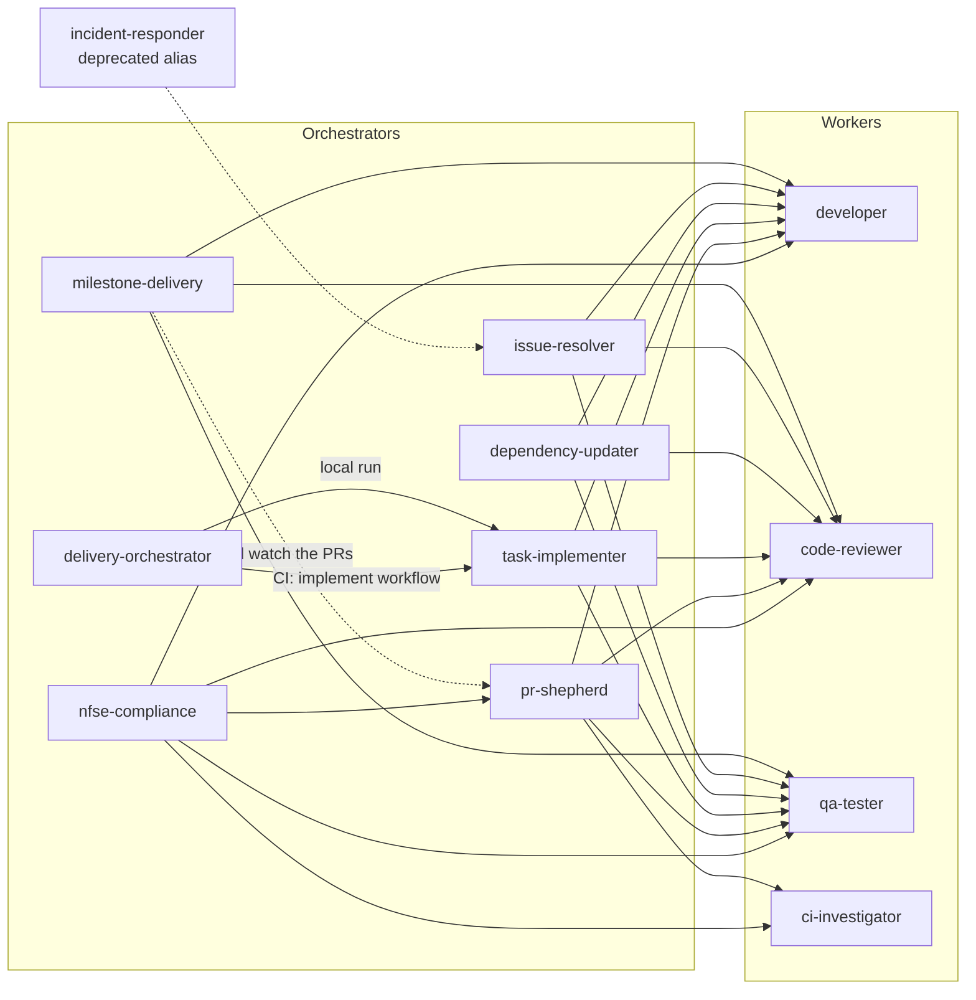
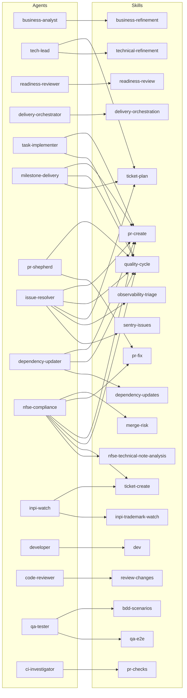
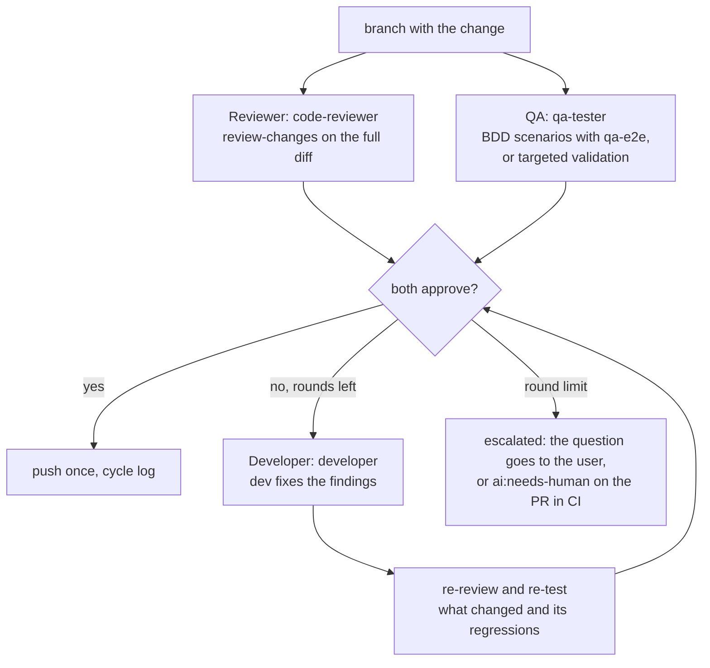

# Agents

Agents built on the skills in this library, for Claude Code (shipped as the `ai-skills` Claude Code plugin) and OpenCode (see [OpenCode](#opencode)). Other harnesses use the skills directly.

## Install

In Claude Code:

```text
/plugin marketplace add fbrissi/ai-skills
/plugin install ai-skills@fbrissi
```

The plugin contains every skill too, so you do not need `npx skills add` for Claude Code. If you also installed the skills with `npx skills add`, Claude Code lists each skill twice (once as `ai-skills:<name>`); keep one of the two.

## Catalog

| Agent | Kind | What it does | Side effects |
| --- | --- | --- | --- |
| `code-reviewer` | Worker | Independent review with `review-changes`; never edits | PR review only when asked |
| `qa-tester` | Worker | Runs BDD scenarios in a browser with `qa-e2e` | QA reports, screenshots |
| `developer` | Worker | Implements a plan or fixes findings with `dev`; local commits | Code edits, local commits |
| `ci-investigator` | Worker | Diagnoses failing CI with `pr-checks`; read-only | None |
| `milestone-delivery` | Orchestrator | Per milestone issue: plan, implement, review and QA cycle, PR | Branches, commits, push, PRs, issue comments |
| `pr-shepherd` | Orchestrator | Takes an open PR to clean: review feedback, CI, review and QA cycle | Commits, push, PR replies |
| `issue-resolver` | Orchestrator | `intake`: source items (Sentry) to deduplicated GitHub issues with severity and the resolve label; `resolve`: one issue to a hotfix or bugfix PR, then stops | Issues, labels, branches, PRs |
| `dependency-updater` | Orchestrator | Open dependency-bot PRs (and optionally outdated packages) to one PR with release notes read, code adapted, checks, and a review and QA cycle; supersedes the bot PRs, then stops | Branch, commits, push, PR |
| `incident-responder` | Deprecated | Alias of `issue-resolver` for one observability error; no longer merges | Issues, branches, PRs |
| `inpi-watch` | Orchestrator | RPI analysis to tracked issues with labels, owner, and due dates | Issues, labels, comments |
| `nfse-compliance` | Orchestrator | NFS-e technical note to estimated issues, implementation, PR, auto-fix, risk rating, optional merge | Issues, branches, PRs, merge when allowed |
| `business-analyst` | Delivery | Source ticket to a milestone with business issues, or questions on the source, with `business-refinement` | Milestone, issues, labels, source comment |
| `tech-lead` | Delivery | Technical plan per issue and safe parallel order, with `technical-refinement` | Issue plans, labels |
| `readiness-reviewer` | Delivery | Ready or back to refinement, with `readiness-review`; never edits bodies | Labels, comments |
| `delivery-orchestrator` | Orchestrator | Starts a milestone's unblocked issues up to a limit, with `delivery-orchestration`; keeps the draft milestone PR, marks it ready, closes the milestone after it merges | Branches, labels, workflow dispatches, PR, milestone |
| `task-implementer` | Orchestrator | One issue on its task branch: `dev`, `quality-cycle`, `pr-create` into the milestone branch | Commits, push, PR, labels |

How the agents delegate to each other:



`inpi-watch` and the delivery agents `business-analyst`, `tech-lead`, and `readiness-reviewer` work alone.

Which skills each agent follows (an agent that delegates uses the skills through its workers):



The review and QA loop that `quality-cycle` runs inside `task-implementer`, `milestone-delivery`, `pr-shepherd`, `issue-resolver`, `dependency-updater`, and `nfse-compliance`:



**Workers** run as subagents. Claude Code picks them by description, or you ask for them by name ("use the code-reviewer agent on this branch"). `quality-cycle` delegates its Reviewer, QA, and Developer roles to them when they are installed.

**Orchestrators** delegate to the workers. A subagent cannot start other subagents, so run an orchestrator as the main agent:

```bash
claude --agent ai-skills:milestone-delivery
```

For scheduled or CI runs, run it non-interactively. It then never waits for input: questions go to the issue or PR, and that item stops there.

```bash
claude -p --agent ai-skills:inpi-watch "process the latest RPI"
```

Started as a subagent instead, an orchestrator plays the roles itself one at a time, as `quality-cycle` describes.

## OpenCode

Every agent is also generated as an OpenCode agent in `plugins/ai-skills/opencode/agent/<name>.md`, with the same body. Copy the folder into the repository's `.opencode/agent/` (or `~/.config/opencode/agent/`) and install the skills with `npx skills add fbrissi/ai-skills -a opencode`. The files use the OpenCode 1.x agent format, which OpenCode 2.x still reads:

```yaml
---
description: >-
  Independent code reviewer. ...
mode: all
name: code-reviewer
permission:
  edit: deny
---
```

- `mode: all`: each agent runs as the main agent (`opencode run --agent <name>`) and as a subagent through the task tool, so orchestrators delegate to the workers the same way.
- `model` is unset: the agent uses the model of the run, or of its parent session.
- `permission.edit: deny` for the agents that cannot write files in Claude Code (`code-reviewer`, `ci-investigator`, `readiness-reviewer`). OpenCode's `edit` permission also covers writing new files, so the agents that may write but not edit in Claude Code (`qa-tester`, `tech-lead`, `business-analyst`) keep `edit` allowed and rely on the rules in their body.

```bash
opencode run --agent milestone-delivery "deliver milestone 3"
```

## Orchestrators

### milestone-delivery

Loads the milestone's open issues, skips the ones assigned to others or already in a PR, orders the rest by dependency and priority, and asks once for approval of the plan. For each issue: `ticket-plan`, a branch, `developer`, `quality-cycle` until `code-reviewer` and `qa-tester` approve, then `pr-create` with `Closes #<n>`. One PR per issue; dependent issues get stacked branches. Never merges. Say "and watch the PRs" to run the `pr-shepherd` loop on each one.

### pr-shepherd

Each round: `pr-fix` on the review comments and CI (in `review` mode it asks before the first push and before replying; in CI it always runs `auto`), then `quality-cycle` on the PR branch, then the `pr-fix` watch loop until CI settles. Repeats while new feedback arrives, up to the round limit. Never merges. With Settle `none` it does one round and finishes with `awaiting events` instead of watching, for a CI workflow that reacts to review events and starts the next run.

### issue-resolver

Two modes, each its own run. `intake` reads a source skill (`sentry-issues` by default) with its profile's filters and keeps one GitHub issue per source item, found by the marker `<!-- ai-issue source=sentry id=<id> -->`: it creates missing issues, refreshes open ones, and reopens closed ones when the item comes back. Each new issue gets a severity label from the delivery profile's hotfix criteria and the resolve label (`ai:resolve`), which starts a resolve run where the repository's workflows react to `issues: labeled`. `resolve` fixes one issue: `observability-triage` (or `ticket-plan` for an issue without a source), then a hotfix branch into the base branch for critical issues or a bugfix branch into the open release branch otherwise (with no release branch it asks which one), a failing test first, `quality-cycle`, and `pr-create`, then it stops. It never waits for approval and never merges: `pr-fix` and the merge decision run on later events. Anything but a high-confidence code defect becomes a blocker comment for `requested-by`. Run on an issue whose PR merged, it marks the source item resolved when the source profile allows it.

```bash
claude -p --agent ai-skills:issue-resolver "intake"
claude -p --agent ai-skills:issue-resolver "resolve issue 42"
```

### dependency-updater

One run per schedule with `dependency-updates`: it collects the open Dependabot or Renovate PRs into the base branch (and outdated packages when the profile asks), reads each package's release notes and upgrade guide, adapts the code with `developer`, holds back what is unsafe with a reason, runs the checks and `quality-cycle` with `code-reviewer` and `qa-tester`, writes the release notes the repository's rules ask for, and opens one PR with `pr-create` that supersedes the bot PRs. A later run updates the PR of an earlier one while it is open. It never closes or merges bot PRs and never waits for approval: `pr-fix` and the merge decision run on later events. A separate agent rather than an `issue-resolver` mode, because there is no issue, severity, or hotfix and bugfix choice to make.

```bash
claude -p --agent ai-skills:dependency-updater "update dependencies"
```

### incident-responder (deprecated)

Kept as an alias so existing callers keep working: it runs `observability-triage` on one error and, for a high-confidence code defect, finds or creates the GitHub issue and resolves it as `issue-resolver` does. It no longer watches the PR or merges. Move callers to `issue-resolver`; the alias will be removed in a later release.

### inpi-watch

Runs `inpi-trademark-watch` for each RPI, then creates or updates `INPI: RPI <n>` with category and urgency labels, the owner, and the earliest deadline as the due date. Optionally one issue per action. When a new dispatch settles or changes an earlier action, it comments on the earlier issue, and closes it only when the profile allows. Never files anything with INPI.

### nfse-compliance

In `scan` mode it finds notes with no issue yet. For each note: `nfse-technical-note-analysis`, then an issue with category labels (tax, layout, API, events, DANFSE, validation), estimates, priority, and due dates from the official dates and rollout plan. Not-applicable notes are recorded and closed. Issues go to the milestone the profile's milestone policy names (a release milestone for deadline work, a tracking milestone for watched work). On resume it reconciles an existing issue with the current profile and sources first, so a policy change fixes old issues instead of duplicating them. Required changes are implemented homologation first on `feature/nfse-nt-<n>-<slug>` (the profile's branch template), go through `quality-cycle` and `pr-create`, then the `pr-shepherd` loop in `auto` mode until a person approves, then `merge-risk` in `decide` mode. With the profile's `PR follow-up: events`, it handles the feedback already on the PR in one pass and stops with `awaiting review`; a CI workflow that reacts to review events runs it again, and a run on an approved PR goes on to the merge decision. It never deploys.

### Delivery flow

`business-analyst`, `tech-lead`, `readiness-reviewer`, `delivery-orchestrator`, and `task-implementer` run one step each of the [delivery flow](delivery-flow.md): business refinement, technical refinement, readiness review, orchestration, and implementation. Each step is its own non-interactive run, usually started by a workflow, and moves issues through the `status:*` labels. Every run ends with one status label per issue in scope and, for each blocked item, a comment starting with `<!-- ai-delivery blocker stage=<stage> -->` and `Blocked: <line>`, plus a `Blocked:` list in its report, so a workflow can chain the next step or hand off to `requested-by`. The first three only change issues; they follow their skill and stop if it is not installed. With a GitHub milestone as the source, `business-analyst` reorganizes the milestone's existing issues in place instead of creating new ones.

`delivery-orchestrator` never codes. In CI it dispatches the implement workflow for each unblocked issue, up to `max-parallel`, and exits; it is re-run when a task PR merges into the milestone branch. Locally it delegates each task to `task-implementer`, or plays that role itself one task at a time when it cannot start subagents. Task PRs target the milestone branch; it opens the milestone PR into the base branch as a draft early, keeps its body current, marks it ready when every issue is done, and closes the milestone after a person approves and it merges.

`task-implementer` checks out the task branch, implements the issue with `developer`, runs `quality-cycle` with `code-reviewer` and `qa-tester` until both approve, opens a PR into the milestone branch with `pr-create`, and marks the issue `in-review`. It never exits with the issue `in-progress`: an escalated cycle still opens the PR, labeled `ai:needs-human`, with the issue `in-review`; an unclear requirement, or an escalation with nothing to push, moves the issue to `technical-blocked`. In CI, QA uses a real browser when the profile's `QA in CI setup` starts a test environment, and otherwise runs targeted validation (focused tests, the app or API headless, smoke checks) without escalating. The PR follow-up (`pr-shepherd` or `pr-fix`, then the repository's merge process) is a separate run. None of these agents merges.

```bash
claude -p --agent ai-skills:delivery-orchestrator "milestone JIRA:ABC-123 max-parallel 2"
```

## Auto-merge

`nfse-compliance` can merge its own PRs. It stops before merging unless every condition holds:

1. **Auto-merge is on.** It is off by default. Turn it on, or off again, in its profile's Automation section (`docs/ai/nfse-technical-note-analysis.md`), or for one run in the request ("no merge", "auto-merge on"). Missing values fall back to `docs/ai/merge-risk.md`.
2. **A person approved the PR** on the current head commit (`Required human approvals`, default 1), CI is green, and no review thread is open.
3. **The risk rating is within the limit** (`Max risk to merge`, default 2), after the profile's risk floors.

The `merge-risk` skill posts its assessment on the PR every time, merged or held. Merges never use admin rights or bypass branch protection, so branch protection remains the final safeguard.

## Profiles

The agents read the profiles of the skills they use:

| Agent | Profiles |
| --- | --- |
| `milestone-delivery` | `delivery` (branch templates), plus the cycle profiles |
| `pr-shepherd` | `quality-cycle`, `review-changes`, `qa-e2e`, `bdd-scenarios` |
| `issue-resolver`, `incident-responder` | `delivery` (branches and `## Issue resolution`), the source skill's (`sentry-issues`), `observability-triage`, plus the cycle profiles |
| `dependency-updater` | `dependency-updates`, `delivery` (base branch and `## Release notes`), plus the cycle profiles |
| `inpi-watch` | `inpi-trademark-watch` (Automation section) |
| `nfse-compliance` | `nfse-technical-note-analysis` (Automation section), `merge-risk`, plus the cycle profiles |
| `business-analyst`, `tech-lead`, `readiness-reviewer`, `delivery-orchestrator` | `delivery` (`docs/ai/delivery.md`) |
| `task-implementer` | `delivery`, plus the cycle profiles |
