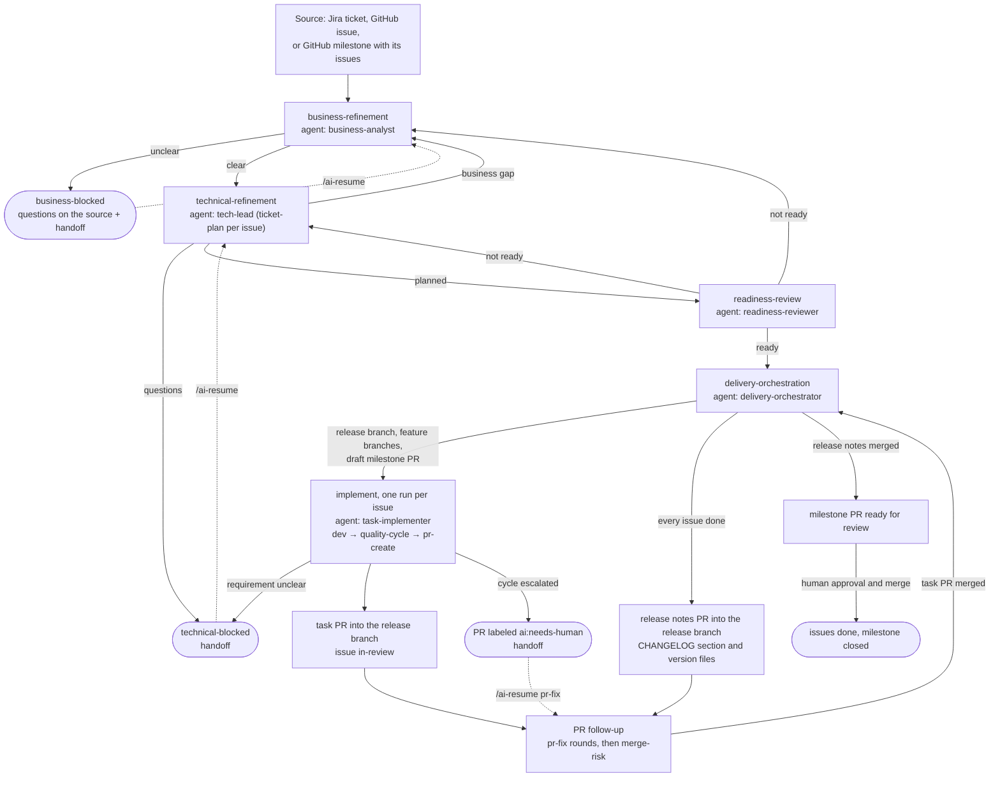
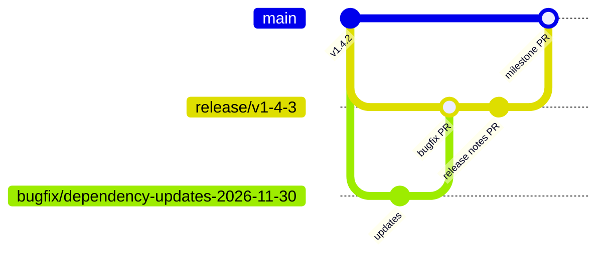
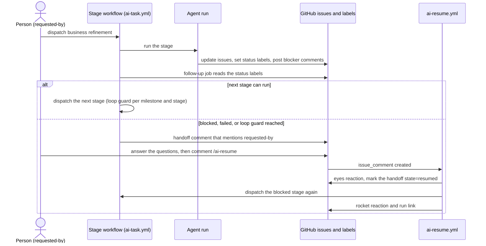
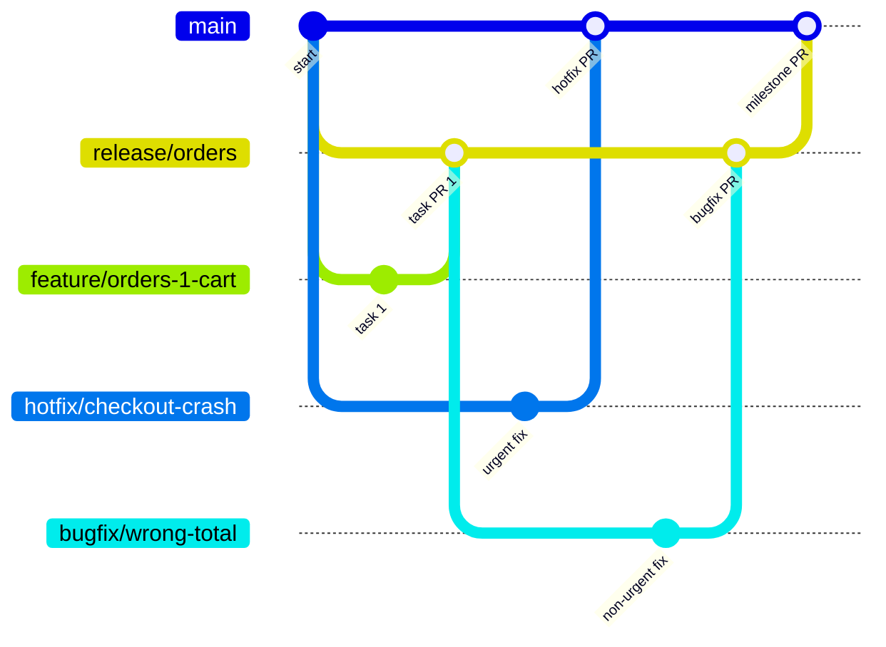
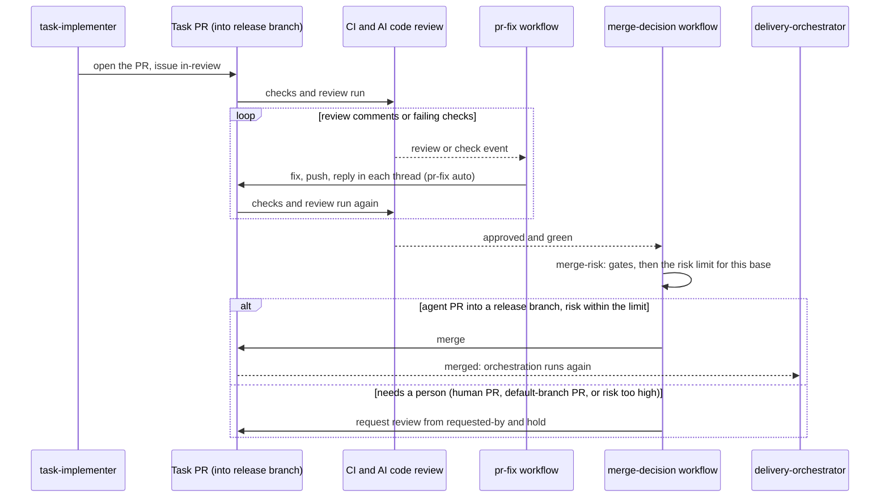
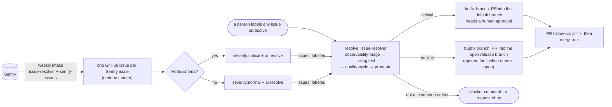
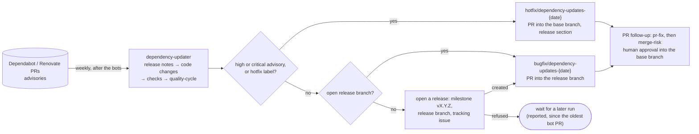
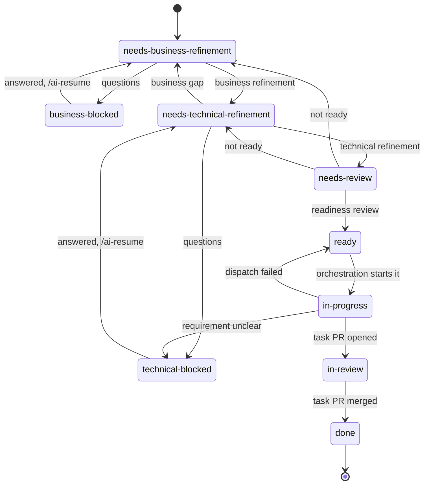

# Delivery flow

Four skills and five agents (Claude Code and OpenCode) take a request from a source ticket to reviewed PRs, one task at a time and in parallel where it is safe. Each step is a separate, non-interactive run, started by a person or by a workflow (for example a GitHub Actions `workflow_dispatch`). Questions never wait for an answer: they go on the ticket or issue, the item moves to a blocked state, and a resume picks up the answer. In CI the steps chain on their own, so one dispatch of the first step runs the whole flow until it needs a person.



Solid arrows run on their own in CI; dotted arrows wait for a person to answer and post `/ai-resume`.

| Task | Agent | Skills | Input | Leaves issues in |
| --- | --- | --- | --- | --- |
| business refinement | `business-analyst` | [`business-refinement`](skills/business-refinement.md) | `source` | `needs-technical-refinement`, or `business-blocked` |
| technical refinement | `tech-lead` | [`technical-refinement`](skills/technical-refinement.md), [`ticket-plan`](skills/ticket-plan.md) | `milestone` or `issue` | `needs-review`, `technical-blocked`, or `needs-business-refinement` |
| readiness review | `readiness-reviewer` | [`readiness-review`](skills/readiness-review.md) | `milestone` or `issue` | `ready`, `needs-business-refinement`, or `needs-technical-refinement` |
| orchestrate | `delivery-orchestrator` | [`delivery-orchestration`](skills/delivery-orchestration.md) | `milestone` | `in-progress`, `done` (back to `ready` when a dispatch fails) |
| implement | `task-implementer` | [`dev`](skills/dev.md), [`quality-cycle`](skills/quality-cycle.md), [`pr-create`](skills/pr-create.md) | `issue`, `branch`, `base-branch` | `in-review` (PR labeled `ai:needs-human` when escalated), or `technical-blocked` |

Every step also takes `requested-by`, the GitHub login of the person who started the flow; see [Requested-by](#requested-by).

## Set up

You need a repository with GitHub Actions, the reusable workflows from [fbrissi/github-actions](https://github.com/fbrissi/github-actions), and this library's skills and agents on the runner. The reusable workflows' README is the reference for their inputs, secrets, and App permissions; the steps below are the order to follow.

1. **GitHub App.** Install a GitHub App on the repository and give the workflows its id and private key, as the github-actions docs name them. Steps act as the App: labels, issues, milestones, branches, PRs, and workflow dispatches. Issue fields need only `issues: write`. A GitHub Project needs the App's organization projects permission.
2. **Secrets.** The harness credentials the reusable workflows ask for, and for a Jira source `JIRA_BASE_URL`, `JIRA_EMAIL`, and `JIRA_API_TOKEN` (read, comment, and attachment download).
3. **Labels.** Create them once (the steps also create a missing label on first use, unless the profile says labels are managed elsewhere):
   - `status:needs-business-refinement`, `status:business-blocked`, `status:needs-technical-refinement`, `status:technical-blocked`, `status:needs-review`, `status:ready`, `status:in-progress`, `status:in-review`, `status:done` (or the names in `status-labels`)
   - `ai:auto-fix` and `ai:needs-human` (PR follow-up)
   - `ai:resolve`, `severity:critical`, and `severity:normal` (issue resolution, or the names in the profile)
   - your hold labels for merges (`merge-risk` default: `do-not-merge`, `hold`)
4. **Project (optional).** With `project`, the issue's single-select Status field must already have an option for each state, by default `Needs business refinement`, `Business blocked`, `Needs technical refinement`, `Technical blocked`, `Needs review`, `Ready`, `In progress`, `In review`, `Done`. Map several states to one option with `project-status-options` (for example `business-blocked=Blocked`). The steps never create options.
5. **Profile.** Add `docs/ai/delivery.md` from the [template](../shared/references/delivery-profile.md#profile-template): repository scope, source tracker, milestone template, base branch, branch templates, and `## Bugfix releases

A bugfix needs an open release branch. When there is none (and `Bugfix release branch` is not `base`), `dependency-updates` and `issue-resolver` open one instead of waiting, unless the profile sets `Open release for bugfixes: no`, and leave the rest to orchestration ([delivery-profile.md](../shared/references/delivery-profile.md#opening-a-release-for-a-bugfix)):

1. The version is computed like the release notes version: the next one above the base branch's changelog, the release tags, and open release branches (`Release version`'s increment, else the next patch).
2. A milestone named after the version (`v1.4.3`, with `<!-- ai-delivery auto-release -->` and the `requested-by` marker in its description) and its release branch from `Release branch template` (default `release/v1-4-3`), created from the default branch, exactly as orchestration names it.
3. A tracking issue in the milestone, `in-progress` then `in-review`: the resolved issue itself, or `Dependency updates <date>` listing the packages. The bugfix PR into the release branch carries `Closes #<issue>` and the milestone.
4. When the bugfix PR merges, orchestration runs for the milestone (the orchestrate-on-merge workflow must also accept `bugfix/` PRs into release branches): it moves the issue to `done`, opens the draft milestone PR, writes the release notes, and marks the milestone PR ready for a human.

Only one auto-opened release takes fixes at a time: once it exists, it is the oldest open release branch, so later bugfixes target it and add their own tracking issues, until its milestone PR is ready for review; a bugfix after that opens a new release with the next version. The release notes use the milestone's version, and a concurrent run that finds the milestone or branch already created reuses it.

Opening a release requires `delivery-orchestration` to run in the repository: an orchestrate workflow and an orchestrate-on-merge workflow that also reacts to `bugfix/` PRs into release branches. Repositories without them set `Open release for bugfixes: no` in the delivery profile (or the dependency profile) and keep the previous behaviour. When the release branch cannot be created (for example a ruleset refuses the ref), dependency updates wait for a later run and issue resolution posts a blocker, each saying why.



## QA in CI`. Add the `quality-cycle`, `review-changes`, `qa-e2e`, and `bdd-scenarios` profiles for the implement step.
6. **Workflows.** Add the stage callers from the github-actions `ai-task.yml` reusable workflow (default files `ai-business-refinement.yml`, `ai-technical-refinement.yml`, `ai-readiness-review.yml`, `ai-orchestrate.yml`, `ai-implement.yml`), the PR follow-up callers (`pr-fix`, `merge-decision`) with branch prefixes that cover the branch model (`feature/ release/ hotfix/ bugfix/`, plus any older prefixes still open), and a caller of `ai-resume.yml` on `issue_comment: [created]`. For production issues, add a weekly intake caller and a resolve caller on `issues: [labeled]` for the github-actions `issue-intake` and `issue-resolve` tasks of `ai-task.yml` (default callers `ai-issue-intake.yml` and `ai-issue-resolve.yml`; see [Issue resolution](#issue-resolution)), a weekly caller for the `dependency-update` task after the dependency bots run (default `ai-dependency-update.yml`; its `hotfix/` and `bugfix/` branches are already in the PR follow-up prefixes; see [Dependency updates](#dependency-updates)), and a `branch-sync.yml` caller on `push` to the default branch when you keep a `develop` mirror.
7. **Versions.** Pin the ai-skills version the workflows install. Release this library first (merging tags `vX.Y.Z`), then github-actions, then bump the pins in your repository.

## Start and chain

Start with one dispatch of the business refinement workflow (`source`, or `jira_key` for Jira, and optionally `requested_by`; it defaults to whoever triggered it). After each step, the workflow reads the milestone issues' `status:*` labels and decides the next one, so the flow continues without a person:

| After | Labels found | Next |
| --- | --- | --- |
| business refinement | any `business-blocked` | handoff to a person |
| | else any `needs-technical-refinement` | technical refinement |
| technical refinement | any `technical-blocked` | handoff |
| | else any `needs-business-refinement` | business refinement |
| | else any `needs-review` | readiness review |
| readiness review | any `needs-business-refinement` / `needs-technical-refinement` | that refinement |
| | else issues `ready` | orchestrate |
| orchestrate | | dispatches implement per startable issue |
| implement | escalated or failed | handoff (resume implement, or pr-fix when a PR exists) |



In CI no step asks or waits: every question point either uses its non-interactive default (for example `pr-fix` in `auto` mode) or ends in a blocker comment and a handoff.

A loop guard limits automatic dispatches per milestone and step (default 3); above it, the workflow hands off instead. A second guard limits send-backs, dispatches back to an earlier refinement step (readiness review back to technical refinement, for example), to 3 per milestone; past it the workflow hands off to the requester to investigate why refinement did not fix the issue. A resume resets both. A failed or timed-out run hands off with the run URL and moves an issue stuck in `in-progress` back to `ready`.

This works because every step leaves a state a workflow can read: one status label per issue in scope, and for each blocked item one comment that starts with `<!-- ai-delivery blocker stage=<stage> -->` and `Blocked: <one line>`, followed by the questions. Each step's output ends with a `Blocked:` list (`- #<issue> <state>: <summary> | questions: <comment URL>`), which the handoff quotes.

A Jira source with open questions and no GitHub issue yet gets a tracking issue `JIRA:<key> - business refinement` in the milestone, labeled `status:business-blocked` and linking the Jira comment, so the handoff has a place to go. It is closed once the answers are folded into the issues.

## Resume

A handoff is one bot comment per blocked issue (or PR) that mentions `requested-by`, names the step, quotes the blocker, links the questions, and says how to continue:

```md
Reply `/ai-resume` (optionally with instructions on the next lines) to continue: technical-refinement -> readiness-review.
<!-- ai-resume stage=technical-refinement milestone=JIRA:ABC-123 issue=42 pr= requested-by=octocat state=open -->
```

Answer the questions where they were asked (the Jira comment or the issue), then post a new comment whose first line starts with `/ai-resume`:

- `/ai-resume` resumes the newest open handoff on that issue or PR.
- `/ai-resume <stage>` resumes that stage (for example `/ai-resume pr-fix`), with or without an open handoff.
- Anything after the stage on the first line, and every following line, is passed to the resumed run as its `instructions`.

The `ai-resume.yml` workflow acts only on comments from people with write, maintain, or admin access (bots are ignored). It adds an `eyes` reaction, marks the handoff `state=resumed` (`Resumed by @<you> -> <run link>`) before it dispatches, so a handoff runs once, then adds a `rocket` reaction and replies with the run link, or replies with the reason when it rejects the command. With no open handoff and no stage, it replies with the stages it knows. Resuming `pr-fix` removes `ai:needs-human`. A collapsed block in the handoff has the equivalent `gh workflow run` command. There is no checkbox to tick.

Skills that stop in CI write their own blocker comment the same way: they mention `requested-by`, say what is missing, and end with the `/ai-resume` line when the repository runs the resume workflow (shared rule: [non-interactive.md](../shared/references/non-interactive.md)).

## Instructions

Every entry point takes an optional `instructions` input (stage workflows, `pr-fix`, `merge-decision`, `code-review`, and `/ai-resume` from the comment). The text is appended to the agent prompt as additional instructions for that run only: chained dispatches do not pass it on. Like `context`, it adds information and constraints and never overrides the skills' rules or a person's decision on the issue.

## Requested-by

`requested-by` is recorded once in the milestone description as `<!-- ai-delivery requested-by=<login> -->` (the rest of the description is kept), and every later step and chained dispatch reads it from there. It is used as the assignee of new issues and PRs instead of `@me` (which fails with an App token), for mentions in handoffs, and as the reviewer requested on the milestone PR. Bots are never mentioned.

## GitHub milestone as the source

A GitHub milestone source needs no description: its existing issues are the request. Business refinement reads all of them with comments and attachments and reorganizes them in place: rewrites each body into the business format (the original text kept in a collapsed `Original request` section), rewords titles, splits an issue holding several deliverables, and merges duplicates into the oldest one (the merged-away issue is closed with a link to the survivor). It never creates a parallel set of issues, never touches issues already `in-progress` or later, and keeps the triage values people set. Technical refinement may later split or merge again, but only for code reasons (areas, dependencies, size), and both keep every issue in the milestone.

## Branches and PRs

The branch model has four kinds of branch, named by templates in the profile (defaults shown):

| Branch | Template (default) | From | PR into |
| --- | --- | --- | --- |
| release | `Release branch template` (`release/{slug}`) | default branch | default branch |
| feature | `Feature branch template` (`feature/{release-slug}-{n}-{slug}`) | its release branch | that release branch |
| hotfix | `Hotfix branch template` (`hotfix/{slug}`) | default branch | default branch |
| bugfix | `Bugfix branch template` (`bugfix/{slug}`) | its target, the open release branch (so the PR carries only the fix, not the default branch's newer changes) | the open release branch (`Bugfix release branch`, else the oldest open one; with none, the flow opens one, see [Bugfix releases](#bugfix-releases)) |



`main` stands for the default branch. A `develop` mirror, when kept, is not drawn: after each merge into `main`, `branch-sync.yml` fast-forwards it to `main`, never with a merge commit.

In the delivery flow the milestone branch is the release branch. A `develop` branch, when kept, is only a mirror of the default branch, fast-forwarded after each merge (the github-actions `branch-sync.yml` workflow). Branches that already exist under older names (for example `feat/<milestone-slug>`) are never renamed and keep being used until merged. Template placeholders and examples: [delivery-profile.md](../shared/references/delivery-profile.md#branch-model).

One milestone produces many PRs, so they are stacked:

1. Orchestration creates the release branch (default `release/<milestone-slug>`) from the default branch (`base-branch`) first.
2. Each feature branch (default `feature/<milestone-slug>-<n>-<slug>`) is created from the release branch, and each task PR targets the release branch. Task PRs go through PR follow-up (`pr-fix` rounds, then `merge-risk`) and may merge on their own when the AI review approved, CI is green, and the risk is low, where the repository enables it. Only PRs the agent App opened into a release branch can skip the human approval; PRs people open, and every PR into the default branch (release and hotfix PRs), need one. `merge-risk` takes the base list and a max risk per base from its profile, so task PRs into `release/*` can use a different limit than PRs into the default branch.
3. One milestone PR, from the release branch into the default branch, aggregates every task PR, so reviewers see one combined diff. Orchestration opens it as a draft as soon as the release branch has a commit, keeps its body current (every issue with `Closes #<n>`, its status and task PR), and marks it ready for review, requesting `requested-by` as reviewer, when every issue is done, the release notes are merged (or not needed), it merges cleanly, and its required checks passed (a failing required check leaves it in draft with a blocker naming the check; checks still pending after about 15 minutes leave it in draft for the next run). It always needs a human approval.
4. **Release notes.** When the profile sets `Release notes file`, orchestration writes them once every issue is done: a new section at the top of that file (heading from `Release heading`, version from `Release version`: the milestone name, or the next patch, minor, or major version) that summarizes the merged task PRs, plus the `Version files`. Release branches take changes only through PRs, so the notes go in their own PR from `Release notes branch template` (default `feature/<milestone-slug>-release-notes`) into the release branch; it follows the same PR follow-up as a task PR, and its merge runs orchestration again, which then marks the milestone PR ready. Without `Release notes file` the step is skipped. When the profile sets `No-release paths` (comma-separated globs, default none) and every change in the milestone matches them, the notes are not needed: no notes PR and no version. The repository's release-note validation must exempt the same paths; the run reads only the profile and never edits workflows. The version counts only release branches with an open PR into the default branch (or an open auto-release milestone), so stale `release/*` branches do not inflate it.
5. When the milestone PR merges, orchestration runs again, moves every issue to `done`, and closes the milestone.

The task PR follow-up is event-driven: each review or CI event starts the next run, and nothing polls.



## Issue resolution

Production problems take a shorter path than milestones, with the [`issue-resolver`](claude-code-agents.md#issue-resolver) agent:

1. **Intake** (for example a weekly schedule) reads the source with [`sentry-issues`](skills/sentry-issues.md) and keeps one GitHub issue per Sentry issue (marker `<!-- ai-issue source=sentry id=<id> -->`, so it never duplicates), with a severity label decided by the profile's `Hotfix criteria` and the `Resolve label` (`ai:resolve`).
2. **Resolve** runs when an issue gets the resolve label (people can label any issue). Critical issues get a hotfix branch into the default branch; the rest get a bugfix branch into the open release branch, opening a release when none is open ([Bugfix releases](#bugfix-releases)). It diagnoses with `observability-triage`, writes a failing test first, runs the review and QA cycle, opens the PR, and stops.
3. **Follow-up** is the usual PR follow-up: `pr-fix` on review and CI events, then the merge decision. Hotfix PRs into the default branch need a human approval.



Configure it in the profile's `## Issue resolution` section and the `sentry-issues` profile; credentials (`SENTRY_AUTH_TOKEN`, `SENTRY_ORG`, optional `SENTRY_BASE_URL`) come from secrets.

## Dependency updates

Dependency bumps follow the issue resolution branch model, with the [`dependency-updater`](claude-code-agents.md#dependency-updater) agent and one run instead of intake plus resolve:

1. **Update** (a weekly schedule after the dependency bots run, for example Monday 12:00 UTC for bots that run at 09:00) follows [`dependency-updates`](skills/dependency-updates.md): it collects the open Dependabot or Renovate PRs into the base branch (and outdated packages when the profile asks) and the open advisories, reads each package's release notes and upgrade guide, adapts the code, holds back what is unsafe, and runs the checks and the review and QA cycle.
2. **Route.** Urgent updates (a high or critical security advisory on the version in use, or a bot PR or issue a person labeled with the `Hotfix label`; a new major alone is not urgent) go to `hotfix/dependency-updates-<date>`, PR into the base branch with its release section. The rest go to `bugfix/dependency-updates-<date>`, branched from and PR'd into the bugfix target (`Bugfix release branch`, else the oldest open release branch), with no release section. Updates the target already has (for example from an earlier bugfix PR while the bot PRs into the base branch stay open) are skipped, not redone. With no release branch to target, the run opens one ([Bugfix releases](#bugfix-releases)) with a `Dependency updates <date>` tracking issue; only when that release branch cannot be created do the non-urgent updates wait for a later run (no blocker; the report says since when and why). A repository without release branches sets `Bugfix release branch: base`.
3. **Follow-up** is the usual PR follow-up for `hotfix/` and `bugfix/` branches: `pr-fix` on review and CI events, then the merge decision, with a human approval for a PR into the default branch. Each PR lists `Supersedes #<n>` for the bot PRs it covers; a later run updates the open PR of its kind. The bots close their own PRs once the updates reach the base branch; the flow never closes or merges them.



Configure it in `docs/ai/dependency-updates.md` (ecosystems, bots, outdated level, packages never to update or to hold, supply chain, extra validation); branches, labels, and the bugfix target come from the delivery profile.

## QA in CI

The implement step runs a review and QA cycle before opening its PR. When the project can provide a browser and a test environment in CI (the profile's `QA in CI setup` command, which installs Playwright or Selenium browsers and starts the stack), QA runs the BDD scenarios for what the task changed in a real browser, writing scenarios for new behavior first. Otherwise QA runs targeted validation: it runs (or writes) focused tests for the new behavior, starts the app or API headless when feasible and exercises the changed endpoints or commands, runs the framework's smoke checks, and reports that evidence in the cycle and the PR body. It never escalates only because there is no E2E setup; adding one later only needs the profile value.

## Attachments

For a Jira source, each issue gets an `## Attachments` section: each attachment's Jira URL and a text description of what it shows (screens, values, error text). Inline images are matched to attachments through Jira's `renderedFields`. Images carry UX/UI and business definitions, so every stage that works from the issue (refinement, readiness review, implementation, review, QA, and PR fixes about an image) downloads and opens every image itself and never relies only on another stage's description; QA compares the implemented UI against the original images. When an image cannot be downloaded, the stage says so, and stops with a question when the image is needed to decide. See [tickets.md](../shared/references/tickets.md#images-in-every-stage).

## Status

Each issue carries one status label, `status:<state>` by default: `needs-business-refinement`, `business-blocked`, `needs-technical-refinement`, `technical-blocked`, `needs-review`, `ready`, `in-progress`, `in-review`, `done`. Each transition replaces the previous label. Override labels with `status-labels` (`state=label` lines). With `project` (`owner/number`), the issue is added to that GitHub Project and its single-select `project-status-field` (default `Status`) is set to the matching option: `project-status-options` maps states to option names (`state=Option name` lines, several states may share one option), and an unmapped state defaults to its Title Case name, for example `In review`. A state with no matching option leaves the field unchanged and is reported. Rules: [work-status.md](../shared/references/work-status.md).



## Triage

Every issue the flow creates or refines carries triage for metrics and future estimates: category labels, Priority, Effort, Start and Target date, Size, and Estimate, written to labels, GitHub Project fields, or organization issue fields as the profile's `## Triage` section names them (the issue field wins when a project field mirrors it). `business-refinement` sets the first values (Start today and a Target from the Estimate when the source has no due date), `technical-refinement` revises them after the plan (splitting anything above the largest size) and fills any date still empty, and `readiness-review` does not pass an issue with a required field missing. Estimates follow the Size scale and the history of similar closed work. Values people set change only when a refinement changes the scope, with a comment. Rules: [triage.md](../shared/references/triage.md).

## Profile

Run inputs override the repository profile `docs/ai/delivery.md` (or `profile`), which overrides the defaults. One profile serves every step: repository scope and code map, source tracker, milestone template, languages, status labels and Project, triage fields, base branch, branch templates, issue resolution, implement workflow, parallel limit, research sources, and free-text context. Template and the full input list: [delivery-profile.md](../shared/references/delivery-profile.md).

## Trackers

Jira sources are read and commented through whatever access the harness has, including the REST API with `JIRA_BASE_URL`, `JIRA_EMAIL`, and `JIRA_API_TOKEN` already in the environment (never printed). Attachments and inline images are downloaded and read. See [tickets.md](../shared/references/tickets.md).
