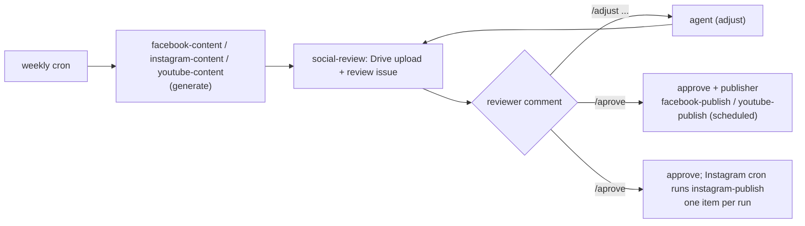

# Social content flow

Generate organic content for Facebook, Instagram, and YouTube from a context the project provides, have a person review it, and publish it only after approval. Generation is done by an agent; review and publishing are deterministic scripts.



## Pieces

| Piece | Kind | Job |
| --- | --- | --- |
| `facebook-content`, `instagram-content`, `youtube-content` | Agents | `generate`: plan, copy, media, copy guard, manifest, review issue. `adjust <issue>`: redo only what `/adjust` comments ask for. Never publish. |
| [`social-content-plan`](skills/social-content-plan.md) | Skill + script | Dated slots and sourced briefs; skeleton manifest |
| [`copy-guard`](skills/copy-guard.md) | Skill + script | Mandatory gate against AI tells, bait, unsupported claims |
| [`image-cards`](skills/image-cards.md) | Skill + script | Cards and thumbnails, Playwright in Docker, offline |
| [`video-shorts`](skills/video-shorts.md) | Skill + scripts + Remotion studio | 9:16 Shorts and Reels with Piper narration, music, credits |
| [`social-review`](skills/social-review.md) | Skill + script | Drive upload, review issue with the manifest marker, `/adjust` requests |
| [`facebook-publish`](skills/facebook-publish.md), [`instagram-publish`](skills/instagram-publish.md), [`youtube-publish`](skills/youtube-publish.md) | Deterministic publishers | Validate, publish or schedule, record idempotent state |

The batch contract is one JSON manifest per platform and batch: [`social-manifest.md`](../shared/references/social-manifest.md) and its [JSON Schema](../shared/references/social-manifest.schema.json). Every social skill carries copies in `references/` and the validator in `scripts/social-manifest.mjs`.

## Profile

One profile per project at `docs/ai/social-content.md`, from [`social-profile-template.md`](../shared/references/social-profile-template.md): audience, goal, offer, allowed claims with sources, forbidden claims, sources and real screens, calendar hooks, voice, and a JSON `## Parameters` block (time zone, UTM, blackout dates, brand, copy guard additions, review label and Drive root, per-platform days, times, formats, and visibility, and the video voice and music).

## Running the agents

All three are main agents (`mode: all` on OpenCode) that work headless.

```bash
claude -p --agent ai-skills:youtube-content "generate"
claude -p --agent ai-skills:instagram-content "adjust 42"
opencode run --agent facebook-content "generate"
```

With the `fbrissi/github-actions` `ai-harness` action, install the agent and the skills it uses: `agent: facebook-content`, `agents: facebook-content`, `skills: social-content-plan copy-guard image-cards video-shorts social-review` (YouTube and Instagram the same with their agent), `prompt: generate` or `prompt: adjust <issue>`.

## Script reference

All scripts are Node.js 22+ ES modules without dependencies, run from the consumer repository root as `node <skill-dir>/scripts/<script>`. Exit code 0 is success, 1 an error or failed check, 2 a usage error.

| Script (skill) | Command |
| --- | --- |
| `social-manifest.mjs` (every social skill) | `validate <manifest> [--profile <md>] [--no-files] [--for-publish] [--now ISO]`; `probe <manifest>`; `approve <manifest> --by <login> [--at ISO]`; `text <manifest> [--item <id>]`; `config <profile> [--platform <p>] [--key <dotted.path>]` |
| `plan-slots.mjs` (social-content-plan) | `--profile <md> --platform <p> [--start YYYY-MM-DD] [--days N] [--now ISO] [--init <batch-dir>]` |
| `copy-guard.mjs` (copy-guard) | `--manifest <file> | --text <file|->` `[--profile <md>] [--lang <code>] [--json]` |
| `render.sh` / `render-cards.mjs` (image-cards) | `--spec <cards.json> --out <dir> [--profile <md>] [--only <id>] [--type png|jpeg] [--quality N] [--html <dir>] [--allow-warnings]` |
| `voice.mjs` (video-shorts) | `--spec <video.json> [--profile <md>] [--work <dir>]` |
| `render.mjs` (video-shorts) | `--spec <video.json> --out <mp4> [--profile <md>] [--work <dir>] [--studio <dir>] [--no-music]` |
| `credits.mjs` (video-shorts) | `[--profile <md>] [--voice <id>] [--no-voice] [--music <file or title>] [--lang <code>]` |
| `drive.mjs` (social-review, video-shorts) | `ensure-folder --path <A/B/C> [--share]`; `upload <file> --folder <id> [--name <n>] [--share]`; `list --folder <id>`; `download <id> --out <path>`; `download-folder --folder <id> --out <dir> [--match <regex>]` |
| `review-batch.mjs` (social-review) | `upload <manifest> [--profile <md>] [--root <name>] [--no-share]`; `issue-body <manifest> [--profile <md>]`; `set-issue <manifest> --issue <n> --url <url>`; `revision-comment <manifest> --changed <ids> [--note <text>]`; `bump <manifest> --changed <ids> [--note <text>]`; `marker <body-file|-> [--out <file>]`; `adjust-requests --issue <n> [--repo <owner/name>]`; `fetch <manifest>` |
| `publish-facebook.mjs` (facebook-publish) | `<manifest> [--execute] [--only <id>] [--retry <id,id>] [--now ISO]` |
| `publish-instagram.mjs` (instagram-publish) | `<manifest> [--execute] [--max N] [--item <id>] [--prefix <template>] [--poll-seconds N] [--timeout-seconds N] [--now ISO]` |
| `publish-youtube.mjs` (youtube-publish) | `<manifest> [--execute] [--only <id>] [--retry <id,id>] [--daily-limit N] [--now ISO]` |

## Environment

| Step | Variables |
| --- | --- |
| Generate and adjust (agent) | harness credentials; `GH_TOKEN` with issues write; `GOOGLE_DRIVE_CLIENT_ID`, `GOOGLE_DRIVE_CLIENT_SECRET`, `GOOGLE_DRIVE_REFRESH_TOKEN` (scope `drive.file`); optional `GOOGLE_API_KEY` (public music folder), `PIPER_PYTHON`, `PIPER_MODEL_DIR` |
| Approve | `GH_TOKEN` to read the issue and check the commenter's permission |
| Restore media before publishing | the `GOOGLE_DRIVE_*` variables |
| Facebook | `FACEBOOK_PAGE_ID`, `FACEBOOK_PAGE_ACCESS_TOKEN`, optional `FACEBOOK_GRAPH_VERSION` |
| Instagram | `FACEBOOK_PAGE_ID`, `FACEBOOK_PAGE_ACCESS_TOKEN`, optional `FACEBOOK_GRAPH_VERSION`, `INSTAGRAM_USER_ID`, `INSTAGRAM_MEDIA_PREFIX`; `R2_ACCOUNT_ID` or `R2_ENDPOINT`, `R2_ACCESS_KEY_ID`, `R2_SECRET_ACCESS_KEY`, `R2_BUCKET`, `R2_PUBLIC_BASE_URL`, optional `R2_REGION` |
| YouTube | `YOUTUBE_CLIENT_ID`, `YOUTUBE_CLIENT_SECRET`, `YOUTUBE_REFRESH_TOKEN`, optional `YOUTUBE_DAILY_UPLOAD_LIMIT` |

## Approve and publish (for workflows)

A deterministic workflow handles `/aprove` (the command is `review.commands.approve` in the profile):

1. Check that the commenter has write, maintain, or admin permission, and that the comment is on an open issue with the `<!-- social-content:batch ... -->` header.
2. `gh issue view <n> --json body -q .body | node review-batch.mjs marker - --out <dir>/manifest.json`, then `node review-batch.mjs fetch <dir>/manifest.json`.
3. `node social-manifest.mjs approve <dir>/manifest.json --by <login>`.
4. Facebook and YouTube: run the publisher with `--execute` right away (they schedule natively). Instagram: store the approved manifest (the issue marker) and let the Instagram cron run `publish-instagram.mjs --execute` on each scheduled run.
5. After every publisher run, write the updated manifest back to the issue body (`review-batch.mjs issue-body ... | gh issue edit <n> --body-file -`), so the next run sees the state. Close the issue when every item is `scheduled` or `published`. An item in `unknown` state needs a person: report it on the issue (the publisher prints `needs a manual check`) and rerun with `--retry <id>` only after confirming it is not live.
